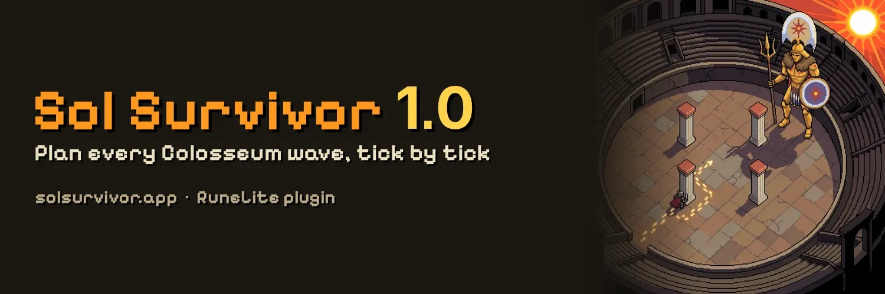

**Plan your Fortis Colosseum waves tick by tick.** Press one button in RuneLite and the wave you're standing in opens
on [Sol Survivor](https://solsurvivor.app/), a free planner in your browser. It works out where to stand, what to
attack and which prayer to have up on every tick, right down to the last kill.

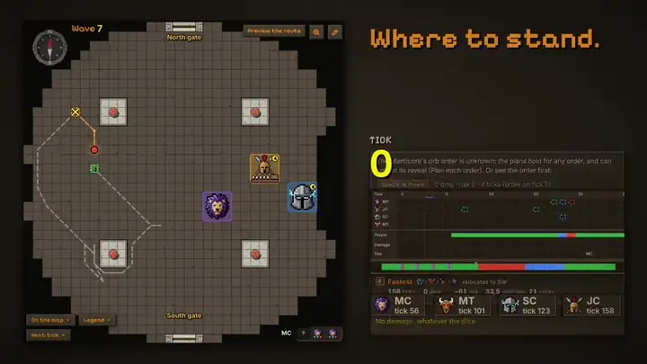

The plugin never plays for you. It reads the arena, turns it into a link and opens that link in your browser. Back in
the game it keeps a list of each wave's NPCs, tells you what went wrong once a wave is over, and shows what hit you if
you die. Anything it draws on your game screen is yours to switch off.

## New in 1.4

- **Names in their attack style's colour.** The wave box tints each NPC's name by how it attacks: blue for magic,
  green for ranged and red for melee. The Manticore, which uses all three, stays white.
- **"also Fortis" marks.** If another plugin you have on already draws the same thing, such as Fortis Colosseum's wave
  box or the Tzhaar/Colo HP Tracker's hitpoints, the Screen tab tells you, so you can switch one of them off.
- **Quiet on Sol Heredit's wave.** The wave box and the clocks step aside for the final fight, where they have
  nothing to tell you. A setting keeps them if you'd rather.
- **Better starting places in the fixed client.** On a fresh install, the clocks and Doom's box start at the top centre
  of the game view, so they don't pile up in the corner. A box you've moved yourself is never touched.
- **Arrows to NPCs out of view** (off by default). An arrow on the edge of the screen for each NPC your camera can't
  see, with its name and how far away it is. It shows only where NPCs are, just as the minimap does.
- **Your potions in the chest verdict.** When you're deciding whether to claim the chest or go on, the site now counts
  the brews and prayer restores you have left against what your waves have been costing you.
- **Ideas and bugs.** Outside the arena, the panel's Wave and Past tabs end with two buttons that open a form on this
  plugin's GitHub page, to suggest a feature or report a bug.

Also new since 1.1: your hit shows on an NPC's hitpoints before it lands, **In range look** lets you choose how NPCs in range are marked,
**Frem and orb colours** outlines the warband by attack style, **Track profit** adds up what each run really made,
the Screen tab has presets to set everything in one go, and the panel shows each update's new settings once.

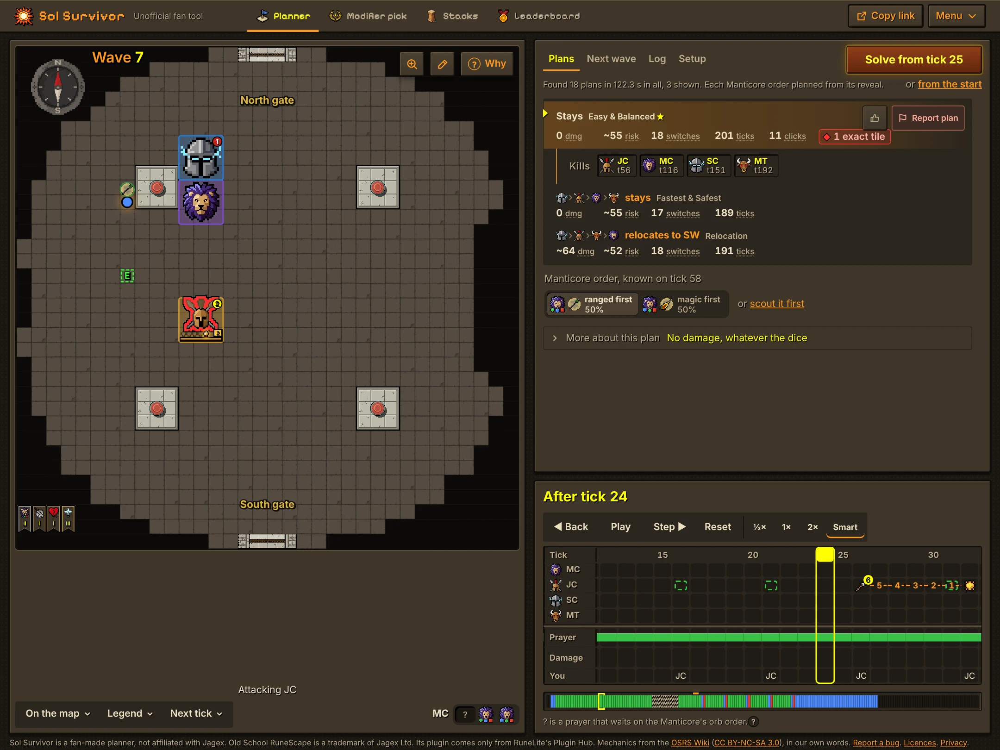

## How it works

1. In the Colosseum, press **Arena now** in the Sol Survivor panel at any point in a wave. Or open **Past waves** and
   press the play button on a wave to open it as it was on its first tick.
2. The planner opens in your browser with the wave exactly as it is in game: the NPCs on their tiles, you on yours,
   and the modifiers you've taken. Each new link replaces the tab the last one opened, so one tab keeps up with you.
3. Press **Solve wave**. The best plans found so far appear as it searches.
4. Pick a plan on the Safe · Fast · Easy triangle and play it through tick by tick: where to run, what to click and
   when to switch prayers.

The site is made for a desktop or laptop browser next to the game, not for a phone.

## Getting started

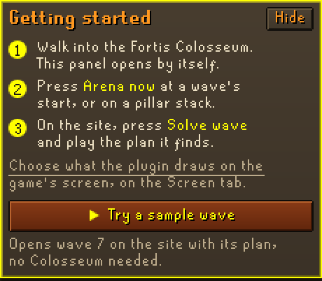

Straight after installing, the panel opens with a **Getting started** card: three steps from the game to a plan, and
**Try a sample wave**, which opens wave 7 on the site with a plan already found, so you can have a look round before
you play. It ticks itself off as you go and disappears once you've opened your first wave, or when you press
**Hide**.

The first time you walk into the Colosseum, one line in your chat box points you to **Arena now**, and the site gives
you a short three-step tour the first time you open a wave there.

 

## A heads-up: your computer does the solving

There's no server working out your plans. The planner runs in your browser, on your own computer, and solving a wave
is hard work.

- **Nothing runs until you press Solve wave.** Opening a link only shows the wave.
- **A solve uses all but one of your processor's threads** (15 at most) for anywhere from a few seconds to a few
  minutes. On a four-thread computer, wave 7 kept the processor 85% busy for two minutes.
- **Your fans may spin up**, a laptop may get warm, and on a computer with lots of threads the tab can use up to about
  2 GB of memory. It all stops when the solve ends.
- **If the game stutters**, solve between waves, or press **Stop**: the plans found so far stay.
- **Picking a modifier solves too**, as it plays the next wave under each of Minimus's offers.
- **In RuneLite the plugin is light.** It notes where everything is each tick, builds a link when you press a button,
  and reads each wave's log once, as the wave ends.

## The panel

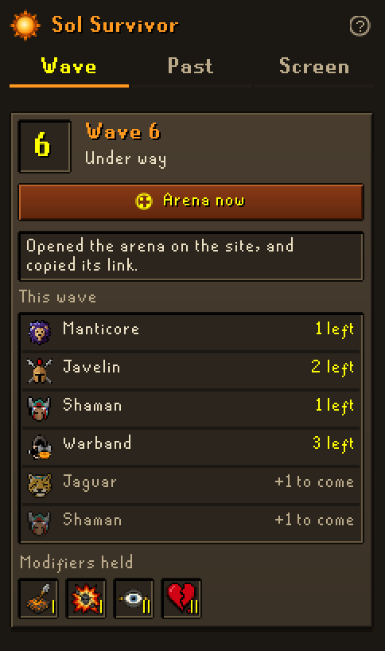

The panel opens by itself when you enter the Colosseum, and from the sun in RuneLite's sidebar at any time. It shows
only what matters right now, across three tabs.

**Wave** is the wave you're in. **Arena now** opens it as it is this tick, fight so far included. Below that, each
NPC by its face with how many are left (struck through as they die), the reinforcements still to come, and the
modifiers you hold, with Doom's stacks as "Doom 4 of 10". Between waves it shows what the next wave brings instead.
When Minimus makes his offers, **Open the pick** takes them to the site's modifier pick.

**Past** keeps your last 25 waves, grouped by run, even after RuneLite closes. Each wave shows its time, the glory it
earned and its mistakes, with buttons to open it from its first tick, open it when the reinforcements arrived, or copy
its log. **Watch** on a run opens the whole run on the site to watch back.

**Screen** lists everything the plugin can draw in the game, each with its own switch (more on that below).

Outside the arena, **Ideas and bugs** at the foot of Wave and Past opens a form on GitHub to suggest a feature or
report a bug.

Every button that opens a link also copies it, so you can share a wave. A hotkey, unset by default, copies the
arena's link without leaving the game.

 

## After each wave

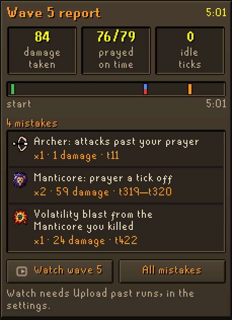

When a wave ends, the panel shows a short report: the damage you took, how many attacks you prayed against on time,
your idle ticks, and your first few mistakes, each with the face of whatever caused it. Nothing shows during the
wave. **All mistakes** opens the full report:

- **Your prayers** against the wave's attacks: on time, a tick off, the wrong one, or none at all.
- **Every mistake by tick**, with what it cost: an attack that got past your prayer, a prayer a tick late or early, a
  Javelin Colossus special or Volatility blast that hit you, Solarflare's orb or the molten sand, and idle ticks.
  "Idle" means you had a living target and a ready weapon but didn't attack, eat or move. Waiting with no target, as
  on a pillar stack, doesn't count.
- **The run so far**: a bar for each wave's mistakes, and the kind you make most.

Each mistake opens the wave on the site at that tick so you can see what happened (this needs **Upload past runs**).
You can switch each kind of mistake on or off under **Mistake tracker** in the settings.

 

## After a death

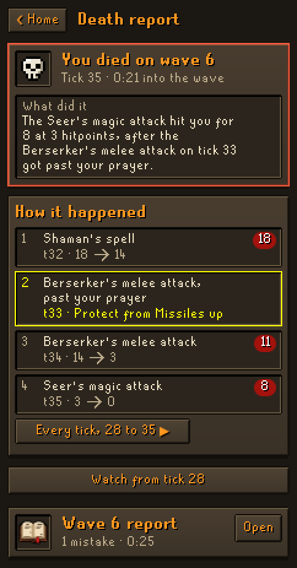

If you die, the panel opens on the death report as you leave the arena. It starts with what killed you, and any
attack that slipped past your prayer just before. Under that are your last 8 ticks: your hitpoints, the prayer you had
up, and every hit with what dealt it. **Watch from tick** opens that moment on the site, and **Home** takes you back to
the rest of the panel.

 

## On your game screen

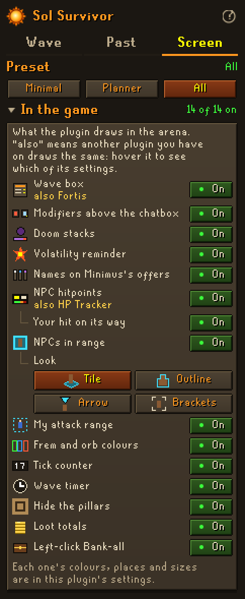

Most of these start switched on so you can see what's on offer. The **Screen** tab lists them all, each with a switch
that works straight away, and three presets (Minimal, Planner and All) to set them in one go. If another plugin of
yours already draws the same thing, its switch says "also Fortis" or "also HP Tracker", so you can keep whichever you
like.

They only ever show what's in the arena. None of them reads a plan, picks a target or marks a tile to stand on.

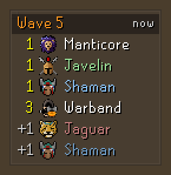

- **Wave box**: this wave's NPCs, the next wave's, or both, by their faces. Names are tinted by attack style, and
  reinforcements still to come read "+1".
- **Tick counter and wave timer**: a tick count from when you enter the arena, with a reset hotkey and an optional
  1-to-N loop in its own colours, and the time since you confirmed your modifier. They can share one box.
- **Modifiers above the chatbox**: the modifiers you hold, with their tiers, at 100% to 300% size.
- **Doom stacks**: "4/10" next to your hitpoints orb, or in a box of its own, red on the last stack.
- **NPC hitpoints**: each NPC's hitpoints over its head, such as "172/250", counted from the hitsplats. Your hit on its
  way shows as "172 › 131" before it lands.
- **My attack range** and **NPCs in range**: the tiles you can hit from where you stand, and the NPCs on them, marked
  as a bold tile, an outline, an arrow or corner brackets.
- **Frem and orb colours**: each Fremennik outlined in its attack style's colour, and the tiles under Solarflare's
  orbs, without pasting NPC ids into another plugin.
- **Volatility reminder**: the modifier's picture over each NPC that dies while you hold it, for 5 ticks.
- **Names on Minimus's offers**: each offer's name and the tier it would bring, such as Frailty III.
- **Hide the pillars**: hides the four pillars so you can see past them. They still block you, so where each stood
  stays marked faintly on the floor.
- **Loot totals** and **Left-click Bank-all**: your loot's value on Minimus's screen, and Bank-all as the reward
  chest's left click.
- **Arrows to NPCs out of view** (off by default): see New in 1.4.

Every box can be moved by holding Alt and dragging, and the colours, places and sizes are all in the settings.

 

## Between waves: which modifier to take

When Minimus makes his offers, press **Open the pick** in the panel. The site fills in his three offers and what you
already hold, solves the next wave under each one, and recommends the offer that costs you least. Each offer also
shows the OSRS Wiki's verdict and what the video guides think of it.

The link carries your run so far and your reward chest too, so the pick also shows:

- **Your title run**: the glory you've earned by the game's rules, the titles you've reached, and how each offer
  moves you towards the one you're aiming for.
- **Claim the chest or go on**: what your chest is worth at Grand Exchange prices against what the next wave adds,
  how your brews and prayer restores are holding up, and a clear verdict: go on, or claim now.

## After a run: watch it back

With **Upload past runs** on, **Watch** uploads a run and opens it on the site: every wave as it happened, to play,
step through or scrub to any tick. Or copy the run and paste it on the site, which reviews it without uploading
anything. The review picks out the moments worth a look, such as the damage you took and the prayer you had up when
it landed.

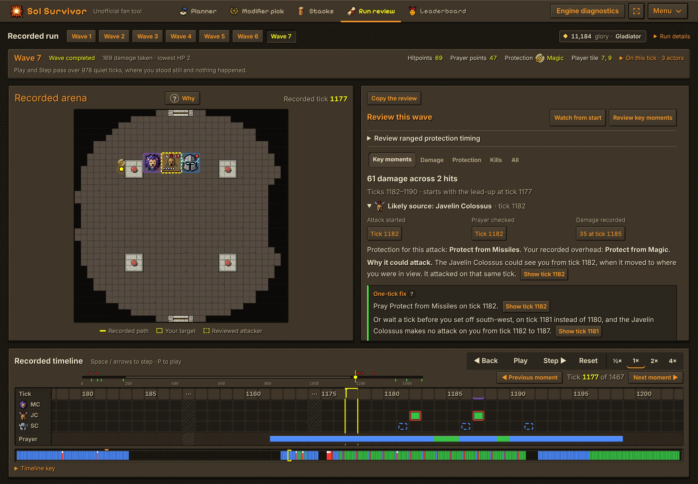

## The leaderboard

Switch on **Leaderboard** (with **Share wave logs**) and each wave you finish goes on the
[Sol Survivor leaderboard](https://solsurvivor.app/leaderboard) under your RuneScape name, or a **Leaderboard name**
of your choosing. There are boards for full runs, single waves and your best waves added up, all timed by the game's
own clock. When a wave ends, the panel and your chat tell you its time and place. A time the game's clock doesn't
back up isn't counted, and one that looks too good to be true is checked before it shows. **Remove my times** takes
your name and every time off and switches the leaderboard off.

## Privacy

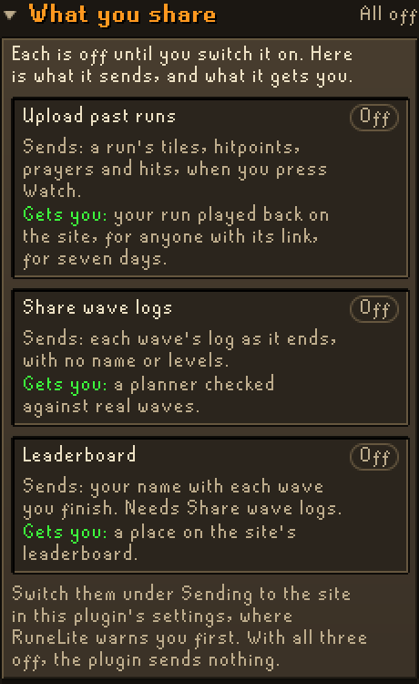

Out of the box, the plugin sends nothing anywhere. **What you share**, at the foot of the panel, lists the three
settings that send anything, whether each is on, and what it sends. You switch them under **Sending to the site** in
the settings, and RuneLite warns you before each one goes on.

 

- **Wave and pick links keep everything after the `#`**, the part of a link your browser never sends to the site's
  server.
- **Upload past runs** (off by default) lets **Watch** send that one run's recording to the site's `/api/replays` over
  HTTPS, only when you press it: tiles, hitpoints, prayers, animations, hits, projectiles and NPC state, plus your gear
  and stats if **Include gear and stats** is on. No account name. The site keeps it for seven days, and anyone with
  its link can watch it.
- **Share wave logs** (off by default) sends each wave's log to the site's `/api/wave-logs` as the wave ends, so the
  planner can be checked against real games. It holds the same kind of data as a recording, the game's own counters
  for the wave and the run (such as Doom stacks and glory), and the wave and its modifiers. The site also uses where
  each wave starts (the NPCs' tiles, yours and the modifiers) to train the planner's Learned ranking. It holds no
  account name, world, time of day, combat levels or prayer unlocks, and your gear only with **Include gear and
  stats** on. A run's waves share a random id the plugin forgets when you leave the arena, so nothing links one run to
  another. The site keeps the day a log arrived, not your address, shows logs to nobody except through the leaderboard,
  and deletes each one after 90 days.
- **Leaderboard** (off by default, and RuneLite warns you that your name goes public) asks for each shared wave to go
  on the board (`/api/board/waves`) under your name, with the run's random id and a random key the plugin keeps in
  RuneLite's settings, so the name and times stay yours. Anyone can see the names, times and modifiers, and watch those
  runs. Logs of a run in a board's top 20 are kept beyond 90 days while it stays there. **Remove my times**
  (`/api/board/remove`) deletes your name and all your times.
- **Upload past runs and Share wave logs each send your IP address** to a server RuneLite doesn't run, which RuneLite
  warns you about. With both off, the plugin sends nothing, whatever the Leaderboard setting says.
- **The reports and everything on your game screen are worked out on your computer** and send nothing.
- **Your wave logs stay on your computer** unless you copy, watch or share them. With **Keep runs between sessions**
  on, the last 25 are saved in RuneLite's folder for this plugin, each account's apart. With **Count my flicks** on,
  RuneLite's settings keep your on-time and late prayer counts from your newest 60 waves, and wave links carry those
  totals after the `#`.

**What a wave link holds:** the NPCs and their tiles, your tile, the wave and the tick, your modifiers, each
Manticore's orb order once it has shown it, and when each NPC last attacked. Mid-wave it also holds the fight so far:
each NPC's health bar as you last saw it, your Doom stacks and the molten sand. With **Include gear and stats** on, it
adds your worn gear, the weapons in your inventory, your combat levels, prayer points and which of the stronger
prayers you've unlocked, so the site can work out how quickly you kill each NPC. With **Send my tile markers** on, it
adds the tiles you've marked in the arena with Ground Markers or Tile Packs, with their colours and labels.

**What a pick link holds:** Minimus's three offers, your modifiers and the wave they come before; each wave of your
run with its time, whether you took damage, the modifiers you held, the game's glory and damage counters, and the
potion doses you drank; the potion doses you're carrying; and your reward chest and the next wave's reward, each item
by name and quantity.

## Settings worth knowing

Every setting has a description in RuneLite. These are the ones people ask about most:

- **Copy link hotkey** copies the arena's link without opening your browser, so the game keeps focus. **Open Arena
  now hotkey** does what the button does. Both are unset by default.
- **Include gear and stats** (on) lets the site work out your kill times from your actual gear.
- **Send my tile markers** (off) puts your Ground Markers and Tile Packs tiles in the arena on the site's map.
- **Messages in chat** (on) puts the plugin's messages in your chat box as well as the panel.
- **Open panel on entering** (on) and **Sidebar icon only at the Colosseum** (off) control when the panel shows.
- **Record wave log** and **Keep runs between sessions** (both on) keep your last 25 waves for Past waves. Switch the
  second off to delete the saved waves.
- **Mistake tracker** decides which mistakes the report counts, how many idle ticks in a row count as one, whether
  the death report shows, and whether the report gets a line in chat.
- **Waves and modifiers** decides what the panel's list and the wave box show: dead NPCs struck through or dropped,
  the warband listed one by one, Doom against its limit, and the biggest groups first.
- **Loot** covers Loot totals, Left-click Bank-all and **Track profit**: a card on the Past tab that adds up each run's
  chest less the food, potions, ammo and runes it used, at Grand Exchange prices, with deaths costing the grave fee.
- **Safe / Fast / Easy** (off) starts every wave you open at your favourite point on the site's triangle. Copy the
  three numbers from the site, such as Safe 10% · Fast 0% · Easy 90%.
- **Prayer reliability** (off), with **Count my flicks**, sets the site's prayer reliability from your own newest 60
  waves, erring on the safe side so a lucky streak never makes the plans harder.

## Report a problem

Spotted a bad plan or a bug? Use the report form on the site: **Send report** goes privately to the planner's Discord,
and **Open as a GitHub issue** opens a public draft for you to check and submit. You can also
[open a bug report here](https://github.com/stefanws0/Sol-Survivor-Plugin/issues/new?template=bug-report.md), or
[suggest a feature](https://github.com/stefanws0/Sol-Survivor-Plugin/issues/new?template=feature-idea.md). The plugin's
panel has both at its foot, outside the arena.

## Credits

Sol Survivor is a fan-made tool and isn't affiliated with Jagex. The game's mechanics come from the
[OSRS Wiki](https://oldschool.runescape.wiki/), and the planner's engine is checked tick for tick against Supalosa's
[LoS tool](https://los.colosim.com/). The modifiers' ids and varbits and the Manticore's orb graphics are the ones
LlemonDuck's Fortis Colosseum plugin reads.
