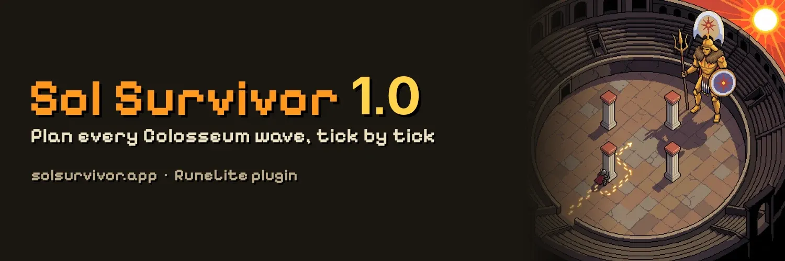
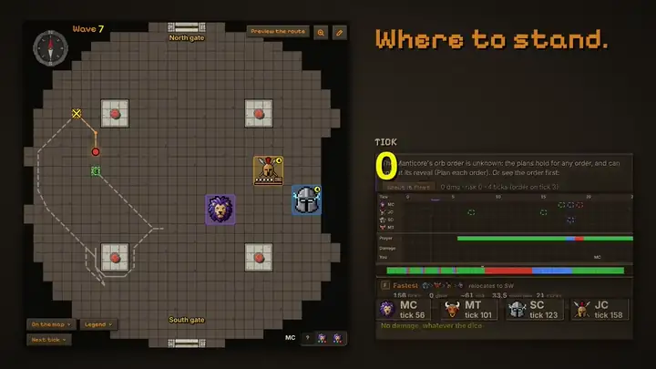
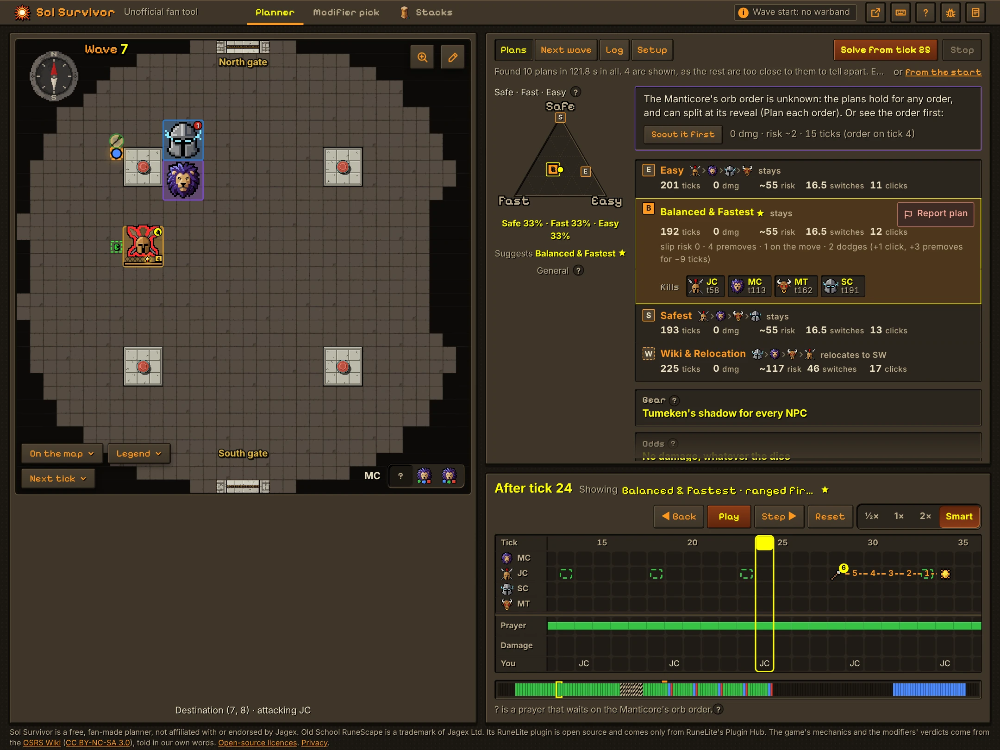
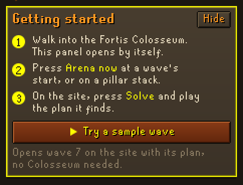
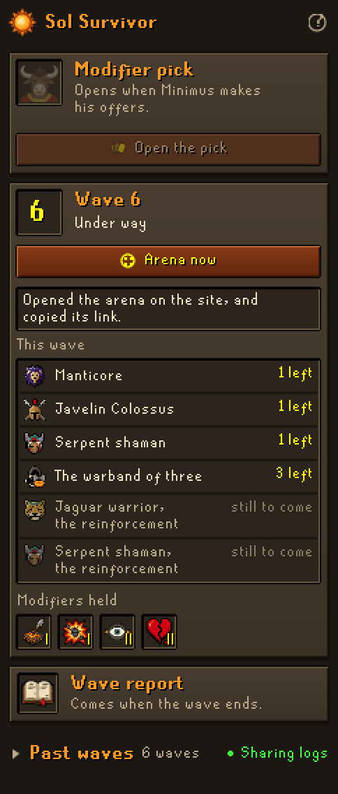
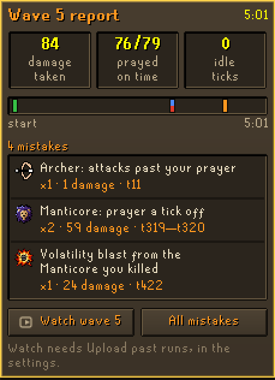
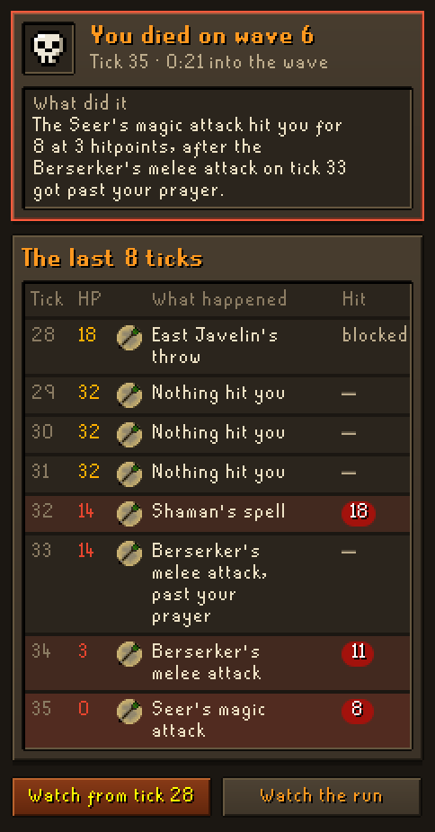
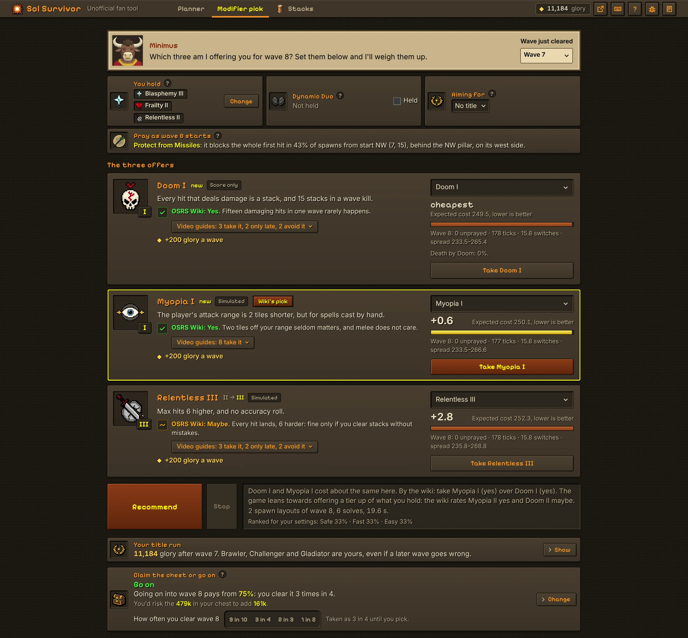
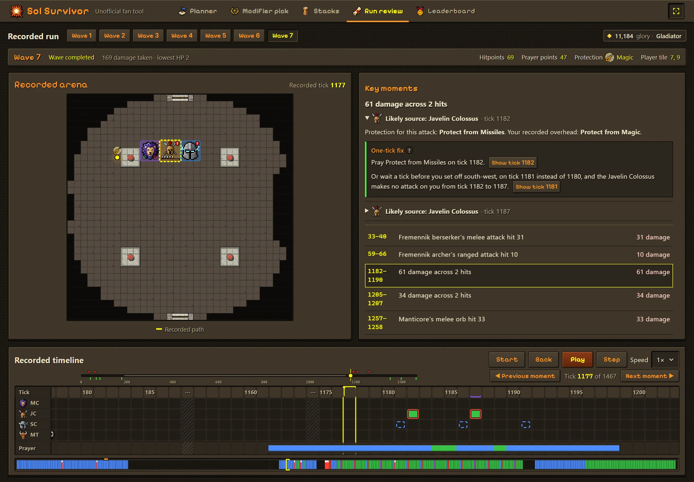
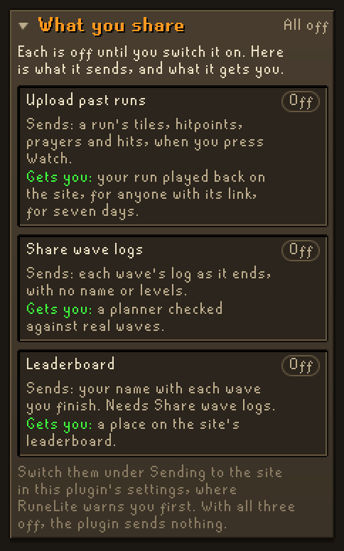

**Plan your Fortis Colosseum waves tick by tick.** Press a button in RuneLite and the wave you are in opens on
[Sol Survivor](https://solsurvivor.app/), a planner in your browser that works out where to stand, what to attack and
which prayer to have up on every tick, down to the last kill.

The plugin never plays for you, and nothing it shows says how to play a wave: it reads the arena, turns it into a
link, and opens that link in your browser. In its panel it lists each wave's NPCs, reports your mistakes once a wave
ends, and shows what hit you after a death. On the game's screen it shows only what you switch on: a box with the
wave's NPCs, and your attack range.

## How it works

1. In the Colosseum, press **Arena now** in the Sol Survivor panel at any point in a wave, or click **Past waves**
   open and press the play button on the wave's line to open it as it was on its first tick.
2. The planner opens in your browser with the wave as it is in game: the NPCs on their tiles, you on yours, and the
   modifiers you took. Each link the plugin opens closes the tab it opened before, so one tab keeps up with you. With **Include gear and stats** on, it also knows how quickly your gear kills each NPC.
3. Press **Solve wave**. Your own computer does the searching, so it gets busy for a while
   ([more on that below](#your-computer-does-the-solving)); the best plans found so far show as it goes.
4. Pick a plan on the Safe · Fast · Easy triangle and play it through tick by tick: where to run, what to click, and
   when to switch prayers.

The site is made for a desktop or laptop browser, beside the game, not for a phone.

## Getting started

Fresh from the Plugin Hub, the panel starts with a **Getting started** card: the three steps from the game to a plan,
and **Try a sample wave**, which opens wave 7 on the site with the plan it found, so that you can look round before
you play. It goes once you have opened a wave from the game, or on **Hide**.

The first time you walk into the Colosseum with the plugin, one line in your chat box says where **Arena now** is, and
on a browser new to the site, the first wave you open there comes with a short tour of its own: three steps on the
wave you came with.

 

## Your computer does the solving

No server works out your plans: the planner runs in your browser, on your own computer, and solving a wave is heavy
work. Expect your computer to notice.

- **Nothing runs until you press Solve.** Opening a link only shows the wave.
- **A solve uses all but one of your processor's threads**, 15 at most, for anything from a few seconds to a few
  minutes: the busier the wave, the longer. On a computer with four threads, a wave 7 kept the processor 85%
  busy for two minutes.
- **Your fans may spin up.** A laptop can get warm and drain its battery faster, and on a computer with many threads
  the tab can take up to about 2 GB of memory. It all stops when the solve ends.
- **If the game stutters**, solve between waves, or press **Stop**: the plans found so far stay.
- **The modifier pick solves too.** It plays the next wave under each of Minimus's offers, which keeps your computer
  busy for a little while.
- **In RuneLite, the plugin is light.** It notes where everything stands each tick, makes a link when you press a
  button, and reads each wave's log once, as the wave ends, for its report.

## The panel

It opens by itself as you enter the Colosseum, and from the sun in RuneLite's sidebar at any time. It wears the Sol
Survivor site's stone look, and each part of it shows only when it is about the moment you are in. The row at the top
is for the wave you are in, with its number. In the arena its **Arena now** opens the wave as it is right now, with the
fight so far, and a line under it says what the last button did; out of the arena it is greyed. To open the wave as
it was on its first tick, press the play button on its line under Past waves, which in the arena opens with a click
on its heading.

In the same row, the panel lists the wave by the NPCs' faces: each with how many are left, struck through as they
die, the reinforcements still to come, and the modifiers you hold by their pictures and tiers, with Doom's stacks as
"Doom 4 of 10", red on the last. Between waves it lists what the next wave brings instead, and the reinforcements that
join it later.

The **Modifier pick** row shows at the top of the panel in the arena, greyed until Minimus offers his three modifiers.
Then it lights up with them, by their pictures and the tier each would be, and **Open the pick** opens the site's
modifier pick with his offers, the modifiers you hold and the next wave filled in.

Each of these also copies its link, so you can share the wave. A hotkey, unset by default, copies the arena's link
without leaving the game.

**Past waves** lists your last 25 waves, grouped by run, newest first, and keeps them when RuneLite closes. Each
wave's line gives its time and the glory it earned, by the game's own counter, and its mistakes, or "clean", once its
report is in; each run adds up its glory under its head. In the arena, Past waves folds into its heading, with how
many waves it holds, to keep the panel clean while you play: click the heading to open it. In the lobby it always
shows. Click a run's head to fold it open or shut. Each wave's line has three buttons:

- The play button opens the wave as it was on its first tick.
- The two-figure button opens it on the tick its reinforcements came.
- The copy button copies the wave's log. Paste it on the site to see where the planner's simulation differed from
  your run.

**Watch**, on a run's head, opens the whole run on the site to watch back. The copy button beside it copies the whole
run for the site's log checker. The question mark at the top of the panel sums all this up.

With **Leaderboard** on, out of the arena a **Leaderboard** row shows the name your waves go up under, with **Open**,
which opens the site's leaderboard, and **Remove my times**.

 

## After each wave: the wave report

As a wave ends, the panel shows its report. Nothing shows while the wave is under way: the report waits for its end.
The panel's card gives the damage you took, the attacks you prayed on time and your idle ticks, and the first five
mistakes, each by the face of what did it. **All mistakes** opens the whole report in the panel, until **Back**:

- **Your prayer against the wave's attacks**: how many met the right protection prayer on time, a tick off, the wrong
  one, or none.
- **The wave's mistakes, by tick**, each with what it cost: an attack that got past your prayer, a protection prayer a
  tick late or off a tick early, a Javelin Colossus special or a Volatility blast that hit you, a hit of Solarflare's
  orb or the molten sand, and idle ticks. Idle is a stretch with a living NPC as your target and your weapon ready in
  which you neither attacked, ate nor took a step: waiting with no target, as on a pillar stack, is not counted.
- **The run so far**, a bar for each wave's mistakes, and the kind the run has most.

Each mistake's button opens the wave on the site's run review on its tick, and **Review on site** at its start, to see
what happened. Like **Watch**, they upload the run, so they need **Upload past runs**. **Copy report** copies the
report as text. Each kind of mistake has its own switch under **Mistake tracker** in the settings, and **Say the
report in chat** puts one line in your chat box as the wave ends.

 

## After a death: the recap

When you die, the panel shows at its top, once you are out of the arena, what did it: the hit that took your last hitpoints and any attack that got past your
prayer in the ticks before. Under it, the last 8 ticks, each with your hitpoints, the protection prayer you had up, and
each hit and what dealt it. **Open at tick** opens the wave on the site's run review on the first of those ticks, and
**Watch the run** the whole run.

 

## In the game

Each of these is off until you switch it on, under **On the game screen** in the settings. They show only what is in
the arena: none of them reads a plan, picks a target or marks a tile to stand on.

- **Wave box**: the panel's list of the wave's NPCs on the game's screen, by their faces, with Doom's stacks, for the
  wave under way, the next wave or both. A rule splits the NPCs at the wave's start from the reinforcements that join
  later. Hold Alt and drag it to move it.
- **Modifiers above the chatbox**: the modifiers you hold in a row of their pictures, with their tiers, just above
  the chatbox. Hold Alt and drag it to move it.
- **Doom by the hitpoints orb**: Doom's stacks against its limit, as "4/10", just left of your hitpoints orb, red on
  the last stack.
- **My attack range**: outlines the tiles you can hit from where you stand, with your weapon's range at its attack
  style, Myopia's cut taken off, and only those in your line of sight.
- **Highlight NPCs in range**: outlines the NPCs you can hit from where you stand, as RuneLite's Attack Ranges and
  Dynamic line of sight plugins do.
- **Volatility reminder**: while you hold Volatility, its picture over each NPC that dies, for 5 ticks, as a reminder
  that it will explode. It does not mark the blast's area.
- **Names on Minimus's offers**: writes each offer's name under its picture when Minimus makes his offers, with the
  tier taking it brings, such as Frailty III, as the Fortis Colosseum plugin does, the tier white for I, blue for II
  and purple for III.
- **Hide the pillars**: stops the game drawing the arena's four pillars, so that you can see past them. They still
  block your path and your line of sight, so where each stood stays marked flat on the floor, a faint square you
  cannot walk onto. Switching it in the arena reloads the scene for a moment.

## Between waves: which modifier to take

When Minimus makes his offers, press **Open the pick** on the panel's Modifier pick. The site fills in his three offers and the
modifiers you hold, solves the next wave on a few spawn layouts under each offer, and recommends the one that costs you
least. Each offer also shows the OSRS Wiki's verdict on it and what the video guides make of it, which decide between
offers that cost about the same.

The link also carries the run so far and your reward chest, so the pick shows two more things:

- **Your title run**: the glory your run has earned, worked out by the game's rules, and the titles it has reached. Set a
  title to aim for, and the pick weighs each offer's glory towards it.
- **Claim the chest or go on**: what your chest holds at Grand Exchange prices against what the next wave adds and how
  often you clear it, which you set, with a verdict: Go on, or Claim now.

## After a run: watch it back

With **Upload past runs** on, **Watch**, on a run in the panel, uploads that run's recording and opens it on the site:
every wave on the arena as it happened, to play, step through or scrub to any tick. Or copy the run with the button
beside it and paste it on the site, which reviews it without uploading anything. The review picks out the moments worth
a look, such as damage you took and the prayer you had up when it landed, and adds up the run's glory and the title it
reached.

## The leaderboard

Switch **Leaderboard** on in the settings, with **Share wave logs**, and each wave you finish goes on the
[Sol Survivor leaderboard](https://solsurvivor.app/leaderboard) under your RuneScape name, or the **Leaderboard name**
you type instead: the full run, each wave, and the sum of
your best waves, timed by the game's own wave clock, with the modifiers you held. As a wave ends, the panel and the
chat say its time and place. Anyone can watch a run on the boards, wave by wave, in the site's run review. A time the
game's clock does not back is not counted, and one that looks too good to be true is held for a look before it shows.
**Remove my times** takes your name and every time of yours off, and switches Leaderboard off.

## Privacy

The panel's **What you share**, at its foot, lists the three settings that send anything, whether each is on, what it
sends and what it gets you. It only shows them: you switch each under **Sending to the site** in the settings, where
RuneLite warns you first.

 

- **A wave or Modifier pick link keeps what it holds after its `#`**, the part of a link that browsers do not send to
  the site's server.
- **Watch uploads only once you turn on Upload past runs, and only when you press it.** It sends the selected
  run's recording to the Sol Survivor site's `/api/replays` over HTTPS: tiles, hitpoints, prayers, animations, hits, projectiles and NPC state, plus your gear and stats when
  **Include gear and stats** is on. It holds no account name. The site keeps the recording for seven days, and anyone
  with its link can view it.
- **Share wave logs is off until you turn it on.** Then each wave's log goes to the site's `/api/wave-logs` as the
  wave ends, so that the planner can be checked against real games: the same tiles, hitpoints, prayer points,
  animations, hits, projectiles and NPC state, the game's own counters for the wave and the run, such as your Doom
  stacks and glory, and the wave and its modifiers. From 0.8.3 the site also trains the planner's Learned ranking on
  where each wave starts, the NPCs' tiles, yours and the modifiers, and on nothing else of the log. It holds no
  account name, world or time of day, and no combat levels or prayer unlocks: your gear only with **Include gear and
  stats** on, and then without them. A run's waves share a random id that the plugin forgets when you leave the
  arena, so that nothing joins one of your runs to another. The site keeps the day a log came, not your address, shows
  the logs to nobody but on the leaderboard, and deletes each after 90 days.
- **The leaderboard is off until you switch it on**, and RuneLite warns as you do that your name goes up in public.
  Then, as the site takes each wave's log, the plugin asks for the wave to go on the leaderboard (`/api/board/waves`)
  under your RuneScape name, or the Leaderboard name you typed, with the run's random id and a random key of yours that
  the plugin makes once and keeps in RuneLite's settings, so that the name and the times stay yours. Anyone can see the names, times and modifiers on the boards and
  watch their runs from the shared logs; the logs of a run in the first 20 places of a board are kept past their 90
  days while it stays there. **Remove my times** (`/api/board/remove`) deletes your name and every time of yours.
- **The wave report, the death recap and what the plugin shows in the game are worked out on your computer** from
  what it already notes, and send nothing.
- **Both are off until you turn them on**, and RuneLite warns as you do that each sends your IP address to a server it
  does not run. With both off, the plugin sends nothing, Leaderboard on or not.
- **Wave logs stay on your computer**, unless you copy one, watch a run or share them. With **Keep runs between
  sessions** on, they are saved in RuneLite's folder for this plugin, each account's apart, and only the last 25 are
  kept. With
  **Count my flicks** on, RuneLite's settings keep how many attacks you prayed against on time or late in your
  newest 60 waves, and the wave links carry those totals after their `#` too.

**What a wave link holds:** the NPCs and their tiles, your tile, the wave and the tick within it, the modifiers you
took, each Manticore's orb order once it has shown it, and when each NPC last attacked. Mid-wave it also holds the fight
so far: each NPC's health bar as you last saw it, your Doom stacks this wave, and the molten sand on the floor. With
**Include gear and stats** on, it also holds your worn gear, the weapons in your inventory, your combat levels, your
prayer points and which of the stronger prayers you have unlocked, from which the site works out how quickly you kill
each NPC.

**What a Modifier pick link holds:** Minimus's three offers, the modifiers you hold and the wave they come before; each
wave of the run you finished, with its time, whether you took damage, the modifiers you held and the game's glory and
wave damage counters as it ended; and your reward chest and the next wave's reward, each item by its name and how many.

## Settings

- **Copy link hotkey**: copies the arena's link as it is now.
- **Include gear and stats**: on by default.
- **Say so in chat**: a line in your chat box when a link is copied, or why it could not be.
- **Open panel on entering**: on by default. Opens the panel as you enter the Colosseum, and RuneLite's sidebar with
  it if it is shut. Open another panel during the run and it stays open until you next come in.
- **Show only at the Colosseum**: off by default. Shows the plugin's sun in RuneLite's sidebar only in the Colosseum
  and its lobby, so Past waves is at hand only there.
- **Record wave log**: on by default. It keeps the last 25 waves for Past waves, up to 1,500 ticks each.
- **Keep runs between sessions**: on by default. Saves those waves on your computer, each account's apart, so that
  Past waves still lists them after RuneLite closes. Switch it off to delete the saved waves; Past waves then lasts
  until RuneLite closes.
- **Mistake tracker**: the wave report and the death recap (see above). They need **Record wave log**.
  - **Track mistakes**: on by default. Shows the wave report as each wave ends.
  - **Say the report in chat**: off by default. One line in your chat box as the wave ends: its mistakes, the damage
    you took and your prayer.
  - **Hits past my prayer**, **Flicks a tick late**, **Javelin specials that hit**, **Volatility blasts that hit**,
    **Solarflare and molten sand** and **Idle ticks**: each on by default, each a kind of mistake the report counts.
  - **Idle from**: 2 ticks by default. How many idle ticks in a row count as a mistake.
  - **Death recap**: on by default. Shows the last ticks before a death.
- **Waves and modifiers**: what the panel's list and the wave box show.
  - **Show the wave's NPCs**, **Show the next wave** and **Show modifiers held**: each on by default.
  - **Mark the dead**: on by default. Strikes each NPC through as it dies; off, the dead drop off the list.
  - **List the warband**: off by default. Lists the Fremennik warband's archer, seer and berserker one by one, rather
    than as one line.
  - **Doom against its limit**: on by default. Shows Doom's stacks as "4 of 10", red on the last, from the game's own
    count.
- **On the game screen**: everything the plugin draws in the game, all off by default (see In the game).
  - **Wave box**: Off, This wave, Next wave or Both.
  - **Modifiers above the chatbox**.
  - **Doom by the hitpoints orb**.
  - **Volatility reminder**.
  - **Names on Minimus's offers**.
  - **My attack range** and **Highlight NPCs in range**.
  - **Range colour**: the colour of the range's outline and of the NPCs in it.
  - **Hide the pillars**.
  - **Hidden pillars' colour**: the colour of the square left on the floor where each hidden pillar stands; set its
    opacity to 0 for none.
- **Loot**: Minimus's loot, both off by default.
  - **Loot totals**: on Minimus's screen between waves, the value of all your loot so far under the last wave's, and
    what it comes to with the next wave's, from the game's own values.
  - **Left-click Bank-all**: makes Bank-all the reward chest's left click, so that one click banks your loot.
- **Sending to the site**: the settings that send something, together.
  - **Upload past runs**: off by default. Lets a run's Watch button upload that run to the site (see Privacy); until
    it is on, pressing Watch says so.
  - **Share wave logs**: off by default. Sends each wave's log to the site as the wave ends (see Privacy). It
    needs **Record wave log**, and the panel says so under Past waves while it is on.
  - **Leaderboard**: off by default. Puts each wave you finish on the site's leaderboard (see The leaderboard), under
    your RuneScape name or the name below. It needs **Share wave logs**.
  - **Leaderboard name**: blank by default, for your RuneScape name. Another name for the leaderboard: 1 to 12 letters,
    digits, spaces, hyphens or underscores.
- **Safe / Fast / Easy**: with **Set the triangle** on, every wave you open from the plugin starts with the site's
  Safe / Fast / Easy triangle where you set it, and so with the plan it suggests, instead of where you last left it.
  Copy the three numbers from the site's readout under the triangle, such as Safe 10% · Fast 0% · Easy 90%; they need
  not add up to 100. Off by default.
- **Prayer reliability**: with **Count my flicks** on, the plugin counts your protection prayers in each wave, on time
  or late, and every wave you open from it starts with the site's Prayer reliability on Mine: as reliable as your
  newest 60 waves show you to be, kept on the safe side, so that a few lucky waves never make the plans harder. It
  needs **Record wave log**. Switch it off to forget the waves counted. Off by default.

## Credits

Sol Survivor is a fan-made tool, not affiliated with Jagex. The game's mechanics come from the
[OSRS Wiki](https://oldschool.runescape.wiki/), and the planner's engine is checked tick for tick against Supalosa's
[LoS tool](https://los.colosim.com/). The modifiers' ids and varbits and the Manticore's orb graphics are the ones
LlemonDuck's Fortis Colosseum plugin reads.
