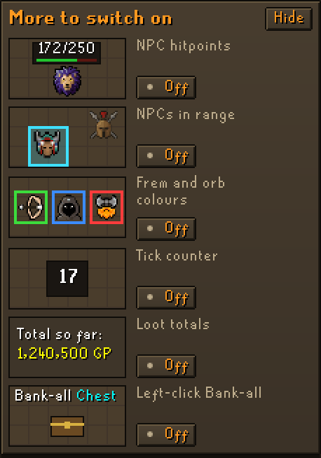

**Plan your Fortis Colosseum waves tick by tick.** Press one button in RuneLite and the wave you're standing in opens
on [Sol Survivor](https://solsurvivor.app/), a free planner in your browser. It works out where to stand, what to
attack and which prayer to have up on every tick, right down to the last kill.

The plugin never plays for you. It reads the arena, turns it into a link and opens that link in your browser. Anything
it draws on your game screen is yours to switch off, and it sends nothing anywhere unless you switch that on.

## How it works

1. In the Colosseum, press **Arena now** in the Sol Survivor panel.
2. The planner opens with the wave exactly as it is in game: the NPCs on their tiles, you on yours, and your modifiers.
3. Press **Solve wave**, pick a plan and play it through tick by tick.

The solving happens in your browser, on your own computer. It keeps most of your processor busy for anywhere from a
few seconds to a few minutes, so your fans may spin up. If the game stutters, solve between waves, or press **Stop**
and keep the plans found so far. Nothing runs until you press Solve wave. The site is made for a desktop or laptop
next to the game, not for a phone.

New here? **Try a sample wave**, on the panel straight after installing, opens wave 7 on the site with its plan, no
Colosseum needed.

## The panel

The panel opens by itself when you enter the Colosseum, and shows only what matters right now.

- **Wave** is the wave you're in. **Arena now** opens it as it is this tick. Under it are the wave's NPCs with how
  many are left, the reinforcements to come and the modifiers you hold.
- **Past** keeps your last 25 waves, grouped by run. Open any wave from its first tick, **Watch** a whole run back on
  the site, and see what each run really made with **Track profit**.
- **Screen** lists everything the plugin can draw in the game, each with its own switch.

Every button that opens a link also copies it. The **?** at the top has the help, and two buttons to suggest a
feature or report a bug.

 

## Between waves: which modifier to take

When Minimus makes his offers, **Open Modifier pick** takes them to the site. It solves the next wave under each
offer and recommends the one that costs you least, beside the OSRS Wiki's verdict. It also shows your title run so
far, and whether to claim the chest or go on, counting the potions you have left.

## After a wave, and after a death

When a wave ends, the panel shows a short report: the damage you took, how many attacks you prayed against on time,
your idle ticks, and your mistakes, each with the face of whatever caused it. **All mistakes** opens every one by
tick. Nothing shows during the wave, and **Mistake tracker** in the settings switches it off.

 

If you die, the panel opens on the death report: what killed you, the hits that led up to it in order, and your last
ticks one by one. If a game tick reached you late in those last ticks, it says which, so you know when it was lag.
**Watch from tick** opens that moment on the site.

 

With **Upload past runs** on, **Watch** opens a run on the site to play back, step through or scrub to any tick.

## On screen

A fresh install starts quietly: the wave box, your modifiers, Doom, the Volatility reminder, the names on Minimus's
offers and the wave timer. **More to switch on**, at the top of the Screen tab, shows the rest with a small picture
of each. Three presets (Minimal, Planner and All) set them in one go, and a switch says "also Fortis" or "also HP
Tracker" when another plugin of yours already draws the same thing.

They only ever show what's in the arena. None of them reads a plan, picks a target or marks a tile to stand on.

 

- **Wave box**: this wave's NPCs, the next wave's, or both, with names tinted by attack style.
- **Tick counter** and **Wave timer**: a tick count with a reset hotkey and an optional loop, and the wave's time.
- **Modifiers above the chatbox**: the modifiers you hold, with their tiers.
- **Doom stacks**: "4/10" next to your hitpoints orb, red on the last stack.
- **NPC hitpoints**: each NPC's hitpoints over its head. **Your hit on its way** shows "172 › 131" before it lands.
- **My attack range** and **NPCs in range**: the tiles you can hit and the NPCs on them. **In range look** marks them
  with a bold tile, an outline, an arrow or corner brackets.
- **Frem and orb colours**: each Fremennik outlined in its attack style's colour, and the tiles under Solarflare's
  orbs.
- **Volatility reminder**: the modifier's picture over each NPC that dies while you hold it.
- **Names on Minimus's offers**: each offer's name and the tier it would bring.
- **Hide the pillars**: hides the four pillars and marks where each stood, since they still block you.
- **Loot totals** and **Left-click Bank-all**: your loot's value on Minimus's screen, and Bank-all as the reward
  chest's left click.
- **Arrows to NPCs out of view**: an arrow on the edge of the screen for each NPC your camera can't see.

Hold Alt and drag to move any box. The colours and sizes are in the settings.

## The leaderboard

Switch on **Leaderboard** (with **Share wave logs**) and each wave you finish goes on the
[Sol Survivor leaderboard](https://solsurvivor.app/leaderboard) under your RuneScape name, or a **Leaderboard name**
of your choosing, timed by the game's own clock. Each account has its own times, so a main and an alt never share
a row, and **Remove my times** takes the name and every time of the account you are logged in on off again.

## Privacy

Out of the box, the plugin sends nothing anywhere. A link keeps everything after the `#`, the part your browser never
sends to the site's server: a wave link holds the arena as you see it, and your gear and levels with **Include gear
and stats** on. Three settings do send, all off until you switch them on, and RuneLite warns you before each one goes
on.

- **Upload past runs** lets **Watch** send that one run's recording to `/api/replays`, with no account name. Anyone
  with its link can watch it for seven days.
- **Share wave logs** sends each wave's log to `/api/wave-logs` as the wave ends, with no account name, to check and
  train the planner. Logs are deleted after 90 days.
- **Leaderboard** puts your name and times on the public board (`/api/board/waves`). **Remove my times**
  (`/api/board/remove`) deletes them.

Each of the three sends your IP address to a server RuneLite doesn't run. For a recorded run, the site keeps a
scrambled form of that address until the day after, which the address can't be read back from: it gives every player
a fair share of the day's uploads.

The reports and everything on your game screen are worked out on your own computer. The site's
[privacy notice](https://solsurvivor.app/privacy.html) has the full detail.

## Settings worth knowing

- **Copy link hotkey** copies the arena's link without opening your browser, and **Open Arena now hotkey** does what
  the button does. Both are unset by default.
- **Include gear and stats** (on) lets the site work out your kill times from your actual gear.
- **Safe / Fast / Easy** picks the plan you'd like suggested: safest, fastest or easiest. By default the site chooses.
- **Prayer reliability** (off) sets the site's prayer reliability from your own last 60 waves.
- **Colours** holds every colour the plugin draws in, in one place.

## New in 1.5

- **A quieter start.** A fresh install draws only the Planner preset, and **More to switch on** pictures the rest. If
  you had the plugin already, whatever you had on stays on.
- **A lighter panel.** Fewer words, the help and Ideas and bugs behind the **?**, clearer reports, and fewer
  sections in the settings: Doom and the modifiers bar sit under **On screen**, every colour under **Colours**.
- **Each account's own leaderboard times.** A main and an alt on one RuneLite profile no longer share a name and
  a row, and a time that didn't reach the site is sent once more before you're told it is missing.
- **A word when the game changes.** If a game update stops the plugin seeing a wave begin, the panel says so.
- **Safe / Fast / Easy** picks the plan the site suggests, in place of the site's old triangle.
- **Was it lag?** If a game tick took a second or more to reach you, the death report and the wave's report say
  which one and how long it took.

## Report a problem

Spotted a bad plan or a bug? Use the report form on the site, or
[open a bug report here](https://github.com/stefanws0/Sol-Survivor-Plugin/issues/new?template=bug-report.md), or
[suggest a feature](https://github.com/stefanws0/Sol-Survivor-Plugin/issues/new?template=feature-idea.md). The panel's
**?** has both.

## Credits

Sol Survivor is a fan-made tool and isn't affiliated with Jagex. The game's mechanics come from the
[OSRS Wiki](https://oldschool.runescape.wiki/), and the planner's engine is checked tick for tick against Supalosa's
[LoS tool](https://los.colosim.com/). The modifiers' ids and varbits and the Manticore's orb graphics are the ones
LlemonDuck's Fortis Colosseum plugin reads.
